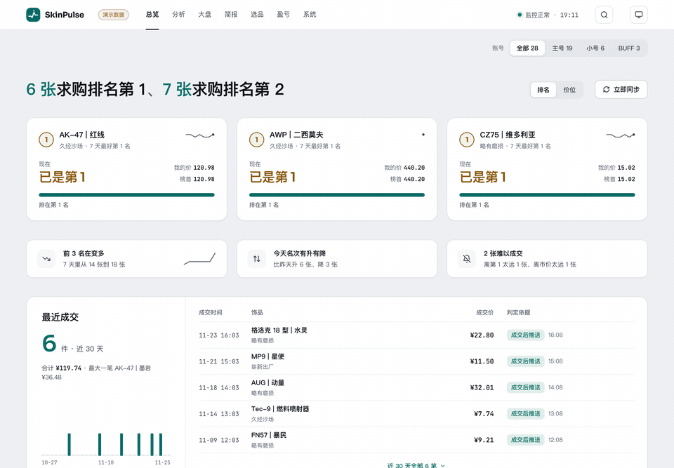
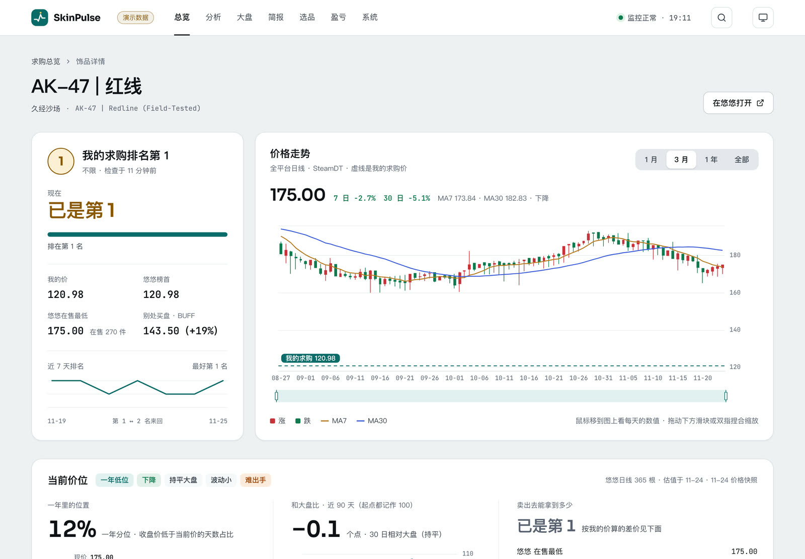
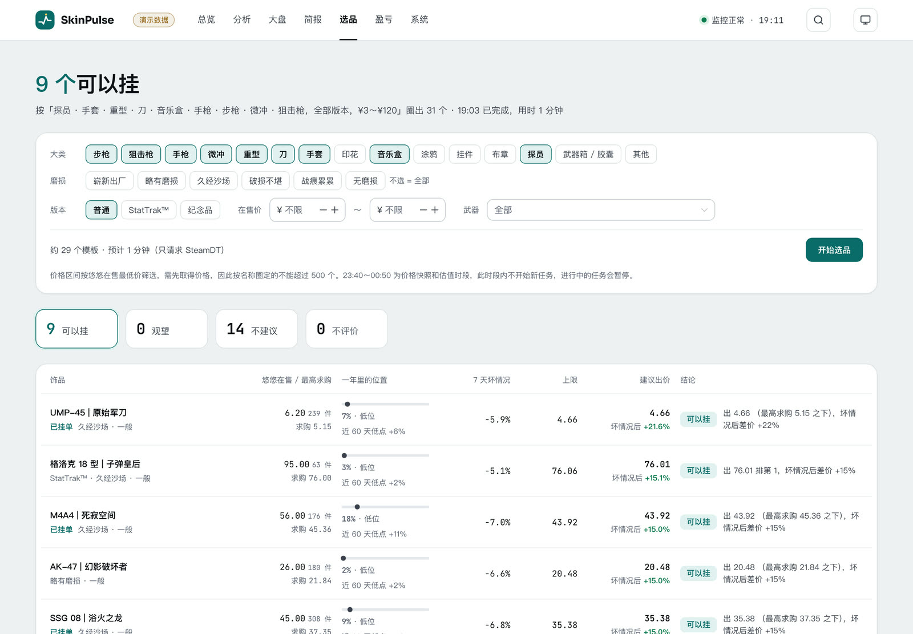

<p align="center">
  <picture>
    <source media="(prefers-color-scheme: dark)" srcset="docs/images/logo-dark.svg">
    
  </picture>
</p>

<h1 align="center">SkinPulse</h1>

<p align="center">Buy-order rank monitor for YouPin898 and BUFF (CS2 skin marketplaces): a WeChat message when your order reaches #1, is being filled, gets filled, or is priced above the market. Read-only — it never places orders.</p>

<p align="center">
  <a href="https://github.com/aft1145/skinpulse/actions/workflows/ci.yml"></a>
  <a href="https://github.com/aft1145/skinpulse/releases"></a>
  <a href="LICENSE"></a>
  
  
</p>

<p align="center">
  <a href="#quick-start">Quick start</a> ·
  <a href="docs/guide.md">User guide (Chinese)</a> ·
  <a href="CHANGELOG.md">Changelog</a> ·
  <a href="README.md">中文</a>
</p>

<p align="center"></p>

SkinPulse watches the buy orders you placed yourself and sends a **WeChat** message when:

- an order climbs to **#1** in its **matching sub-queue** (same item, same float range, same pattern / phase);
- someone sells to you (**in trade**), or the order is **filled**;
- your bid ends up above the market price (**inverted**).

Rank #2 is not pushed in real time; a top-2 table goes out every day at 00:00. Orders that sit too far below the leader or the market to ever fill ("hard to fill") are not pushed and can be hidden on the dashboard. A local dashboard shows rankings, item price history, the overall market and profit and loss, helps you judge whether a bid is reasonable, and suggests items worth bidding on. It can watch several YouPin accounts at once (each message names the account) and your BUFF buy orders too (read-only).

The UI and the user guide are in Chinese. Below, interface labels are given as 中文 (English meaning).

## What it does

| | |
|---|---|
| Push (PushPlus → WeChat) | Reached #1, in trade, filled, inverted price, login expired; a top-2 table every day at 00:00 |
| 总览 (Overview) | Your best-ranked orders, every order's rank, distance to #1 and to the market, recent fills; hard-to-fill orders can be hidden |
| 价位 (Price position) | Each order's percentile over the past year, trend, performance against the market, margin after fees, and "consider cancelling / lowering / raising" advice |
| 详情 · 大盘 (Item · Market) | Multi-platform prices and K-line charts per item, the CS2 market index (SteamDT) |
| 选品 (Picker) | Filter items by category, float and price, and judge which are worth a buy order and at what price |
| 盈亏 (P&L) | YouPin and BUFF trades matched first-in-first-out across platforms: realised, unrealised (at market or net price), by month, by category and item; whether holdings are in inventory, rented out or unaccounted for |
| 简报 · 分析 · 系统 (Brief · Analysis · System) | The daily top-2 table; rank distribution and changes, a check of paused orders before topping up your balance (would they become #1 or inverted once active again); service and push-channel health, settings |

| Item detail | Picker |
|---|---|
|  |  |

(Screenshots and the animation come from `skinpulse demo`; all orders and prices are fake.)

## Read this first

- **Unofficial**: this project has nothing to do with YouPin898, NetEase BUFF, SteamDT or PushPlus and is not authorised by them. It uses the same endpoints their own web pages and apps use; they can change them, rate-limit or block them at any time, and SkinPulse may stop working.
- **Read-only**: it only calls query endpoints (buy-order queues, your buy orders, trades, account info). It never places, edits or cancels an order.
- **Your account, your risk**: your YouPin token and BUFF cookie are as good as a login. They stay in your own computer's keychain and SkinPulse never sends them anywhere except the platform they belong to. Whether using a third-party tool breaks a platform's rules or triggers its risk controls is for you to judge.
- **Not investment advice**: price positions, advice and picks are statistics over past prices, for reference only.
- **macOS and Windows 10/11**: the author's own long-running instance is on macOS; Windows has CI, and autostart was checked on a real Win11 machine. The UI and docs are in Chinese.

## Requirements

| | |
|---|---|
| OS | macOS, or Windows 10/11 |
| Python | ≥ 3.12, managed with [uv](https://docs.astral.sh/uv/); no Node needed (the dashboard is prebuilt) |
| Accounts | YouPin898 (required, read-only); BUFF (optional, read-only, web cookie); [PushPlus](https://www.pushplus.plus) (WeChat push, free, needs real-name verification); a [SteamDT](https://steamdt.com) open-platform key (optional: market data, price position, picker) |
| Push | PushPlus → WeChat official account; [ntfy](https://ntfy.sh) optional as a fallback |

## Quick start

You need macOS or Windows 10/11, Python ≥ 3.12 and [uv](https://docs.astral.sh/uv/). The dashboard frontend is prebuilt in the repository, so no Node.

**1. Try it with fake data** (no account, no network):

```bash
uv sync
uv run python -m skinpulse demo
```

Your browser opens <http://127.0.0.1:8799>. The fake data lives in a temporary directory and every write is refused.

**2. Connect your own accounts:**

```bash
uv run python -m skinpulse init-config                               # writes settings.toml
uv run python -m skinpulse pushplus-token --from-file pushplus.txt   # WeChat push; sends a test message
uv run python -m skinpulse set-token --from-file token.txt           # the YouPin token copied from your browser
uv run python -m skinpulse steamdt-key                               # optional: SteamDT key for market data and price position
uv run python -m skinpulse steamdt-items                             # with a key: sync the item ID mapping (at most once a day)
uv run python -m skinpulse run                                       # monitor + dashboard at http://127.0.0.1:8765
```

How to copy the YouPin token and how to get PushPlus and SteamDT credentials is in the [user guide](docs/guide.md#快速开始) (Chinese). Credentials go into the system keychain; delete those text files afterwards. BUFF accounts are added on the dashboard under 系统 (System) → 添加账号 (Add account); see [user guide · BUFF](docs/guide.md#buff).

**3. Start at login** (starts when you log in, restarts after a crash, keeps the machine awake on AC power):

```bash
scripts/macos/launchagent.sh install                 # macOS (LaunchAgent)
uv run python -m skinpulse service install           # Windows (registry Run key + supervisor, no admin needed)
```

On Windows, enter credentials with `--from-file` (pasting into the console's hidden prompt can add invisible characters); see the [user guide](docs/guide.md#6-开机自启).

## Documentation

- [User guide](docs/guide.md) (Chinese): installation, login, every setting, every feature and its trade-offs.
- [Changelog](CHANGELOG.md).
- [Architecture decisions (ADR)](docs/decisions/): why things are the way they are.
- [Endpoint field notes](docs/research/): how the YouPin, BUFF, SteamDT and PushPlus endpoints actually behave.
- [Known issues](docs/known-issues.md).
- Development: [CLAUDE.md](CLAUDE.md) (commands, conventions, pitfalls), [REVIEW.md](REVIEW.md) (review checklist), [Contributing](CONTRIBUTING.md). `uv run pytest -q`, `npm --prefix frontend test`.

## Acknowledgements

- [Steamauto](https://github.com/Steamauto/Steamauto)'s public research on the YouPin endpoints saved us a lot of detours (SkinPulse's code is an independent implementation).
- [SteamDT](https://steamdt.com) for market data, [PushPlus](https://www.pushplus.plus) for WeChat push, [SteamTradingSite-ID-Mapper](https://github.com/EricZhu-42/SteamTradingSite-ID-Mapper) for the item ID mapping.

## License

[MIT](LICENSE).
