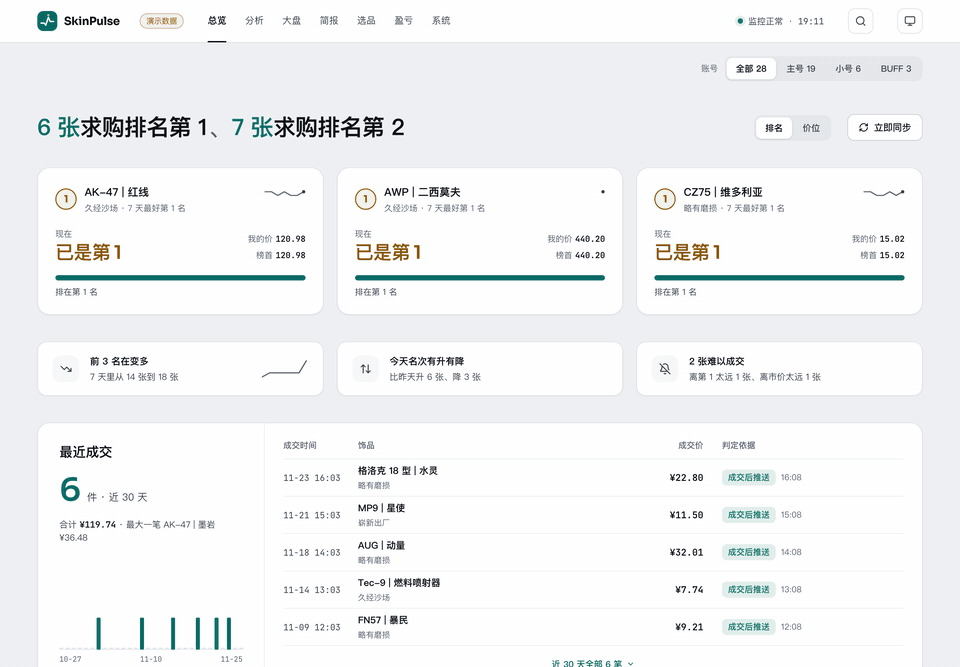
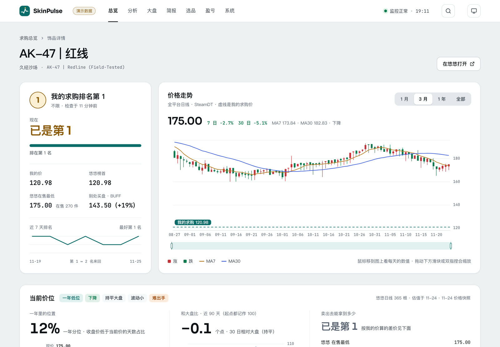
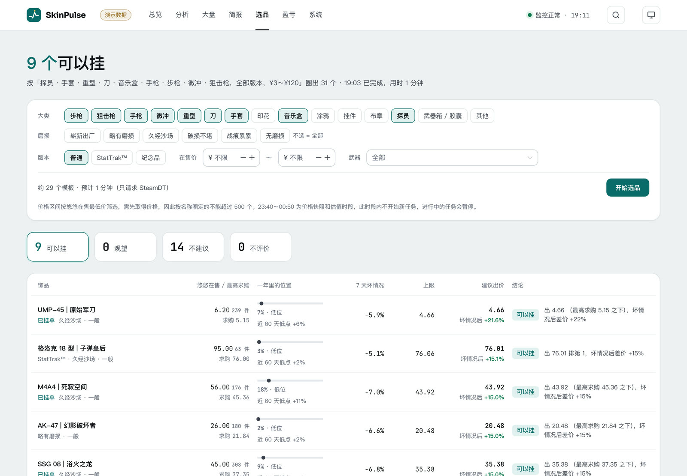

<p align="center">
  <picture>
    <source media="(prefers-color-scheme: dark)" srcset="docs/images/logo-dark.svg">
    
  </picture>
</p>

<h1 align="center">SkinPulse</h1>

<p align="center">悠悠有品 / BUFF 求购排名监控：升到第 1 名、交易中、成交、市价倒挂时推送到微信。只读，不下单。</p>

<p align="center">
  <a href="https://github.com/aft1145/skinpulse/actions/workflows/ci.yml"></a>
  <a href="https://github.com/aft1145/skinpulse/releases"></a>
  <a href="LICENSE"></a>
  
  
</p>

<p align="center">
  <a href="#快速开始">快速开始</a> ·
  <a href="docs/guide.md">使用手册</a> ·
  <a href="CHANGELOG.md">更新记录</a> ·
  <a href="README.en.md">English</a>
</p>

<p align="center"></p>

盯着你自己挂的求购单，在这些时候往**微信**推一条消息：

- 某张单在**同条件子队列**（同款式、同磨损区间、同异色 / 纹理）里升到**第 1 名**；
- 有人卖给了你（**交易中**）、**求购成交**；
- 你的求购价已经高过市价（**市价倒挂**）。

第 2 名不实时推，每天 00:00 发一张前 2 名表。离第 1 名或离市价太远、实际上求购不到的单（「难以成交」）不推送，看板上也可以隐藏。另外还有一个本地看板，看排名、单品走势、大盘、盈亏，判断价位值不值，帮你挑可以挂求购的饰品。可以同时盯几个悠悠号（推送里写明是哪个号），也能盯 BUFF 上的求购单（只读）。

## 能做什么

| | |
|---|---|
| 推送（PushPlus → 微信） | 升到第 1 名、交易中、求购成交、市价倒挂、登录失效；每天 00:00 发前 2 名表 |
| 总览 | 排得最好的几张、全部求购的名次、离第 1 名和离市价差多少，最近成交；难以成交的单可隐藏 |
| 价位 | 每张单在一年里的分位、走势、相对大盘、扣完手续费的差价，以及「考虑撤单 / 降价 / 加价」的建议 |
| 详情 · 大盘 | 单品的多平台价格和 K 线、CS2 大盘指数（SteamDT） |
| 选品 | 按大类、磨损、价格圈出一批饰品，判断哪些值得挂求购、挂多少 |
| 盈亏 | 悠悠和 BUFF 的买卖跨平台先进先出配对：已实现、持仓浮动（按市价或到手价）、每月、按品类和单品；持仓在库存、租出还是去向不明 |
| 简报 · 分析 · 系统 | 每天的前 2 名表；排名分布和变化、充值前检查暂停中的单恢复后会不会倒挂或直接第 1；服务和推送通道的健康状况、参数设置 |

| 饰品详情 | 选品 |
|---|---|
|  |  |

（截图和动图来自 `skinpulse demo`，单子和行情全是假的。）

## 先读这个

- **非官方**：本项目与悠悠有品、网易 BUFF、SteamDT、PushPlus 没有任何关系，也没有得到它们的授权。用的是网页和 App 自己在用的接口，对方随时可能改接口、限流或封禁，SkinPulse 随时可能失效。
- **只读**：只调用查询类接口（求购列表、我的求购单、订单、账号信息），从不下单、不改价、不撤单。
- **账号风险自担**：你的悠悠 token、BUFF cookie 等同于登录态，只存在你自己电脑的钥匙串里，SkinPulse 不会把它们发到对应平台以外的任何地方。但用第三方工具访问账号是否违反平台规则、会不会被风控，要你自己判断和承担。
- **不构成投资建议**：价位、建议、选品都是按历史价格做的统计，只是参考。
- **macOS 和 Windows 10/11**：作者自己的长期实例跑在 macOS 上；Windows 有 CI，开机自启在 Win11 真机上验收过。界面和文档都是中文。

## 需要什么

| | |
|---|---|
| 系统 | macOS，或 Windows 10/11 |
| Python | ≥ 3.12，用 [uv](https://docs.astral.sh/uv/) 管理；不需要 Node（看板已经构建好） |
| 账号 | 悠悠有品（必需，只读）；BUFF（可选，只读，网页 cookie）；[PushPlus](https://www.pushplus.plus)（微信推送，免费，要实名）；[SteamDT](https://steamdt.com) 开放平台 key（可选：行情、价位、选品） |
| 推送 | PushPlus → 微信公众号；[ntfy](https://ntfy.sh) 可选作兜底 |

## 快速开始

需要 macOS 或 Windows 10/11、Python ≥ 3.12 和 [uv](https://docs.astral.sh/uv/)。看板前端已经构建好放在仓库里，不需要 Node。

**1. 先用假数据看看**（不需要账号，不联网）：

```bash
uv sync
uv run python -m skinpulse demo
```

浏览器会打开 <http://127.0.0.1:8799>。假数据放在一个临时目录里，写操作都会被拒绝。

**2. 接上自己的账号：**

```bash
uv run python -m skinpulse init-config                               # 生成 settings.toml
uv run python -m skinpulse pushplus-token --from-file pushplus.txt   # 微信推送，会发一条测试消息
uv run python -m skinpulse set-token --from-file token.txt           # 浏览器里复制的悠悠 token
uv run python -m skinpulse steamdt-key                               # 可选：SteamDT key，用于行情和价位
uv run python -m skinpulse steamdt-items                             # 有 key 时：同步饰品 ID 映射（一天最多一次）
uv run python -m skinpulse run                                       # 监控 + 看板 http://127.0.0.1:8765
```

悠悠 token 的复制方法、PushPlus 和 SteamDT 怎么申请，见[使用手册](docs/guide.md#快速开始)。凭据存在系统钥匙串里，用完把那几个文本文件删掉。BUFF 号在看板「系统」页 →「添加账号」里加，见[使用手册 · BUFF](docs/guide.md#buff)。

**3. 开机自启**（登录即起、崩了自动拉起、接电源时不睡）：

```bash
scripts/macos/launchagent.sh install                 # macOS（LaunchAgent）
uv run python -m skinpulse service install           # Windows（注册表 Run 键 + 守护进程，不需要管理员）
```

Windows 上录凭据请用 `--from-file`（控制台隐藏输入框粘贴会混进看不见的字符），细节见[使用手册](docs/guide.md#6-开机自启)。

## 文档

- [使用手册](docs/guide.md)：安装、登录、每个参数、每个功能的细节和取舍。
- [更新记录](CHANGELOG.md)。
- [设计决定（ADR）](docs/decisions/)：为什么是现在这个样子。
- [接口实测记录](docs/research/)：悠悠、BUFF、SteamDT、PushPlus 的接口实际怎么表现。
- [已知问题](docs/known-issues.md)。
- 开发：[CLAUDE.md](CLAUDE.md)（命令、约定、坑）、[REVIEW.md](REVIEW.md)（评审清单）、[参与贡献](CONTRIBUTING.md)。`uv run pytest -q`、`npm --prefix frontend test`。

## 致谢

- [Steamauto](https://github.com/Steamauto/Steamauto) 公开的悠悠接口研究，帮我们少走了很多弯路（SkinPulse 的代码是独立实现的）。
- [SteamDT](https://steamdt.com) 的行情接口，[PushPlus](https://www.pushplus.plus) 的微信推送，[SteamTradingSite-ID-Mapper](https://github.com/EricZhu-42/SteamTradingSite-ID-Mapper) 的饰品 ID 映射。

## 许可证

[MIT](LICENSE)。
